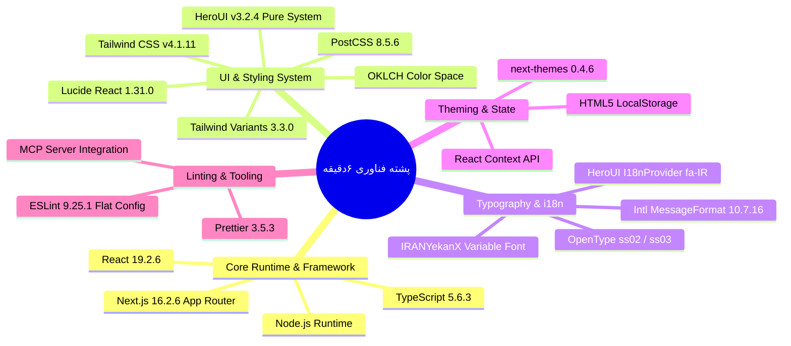
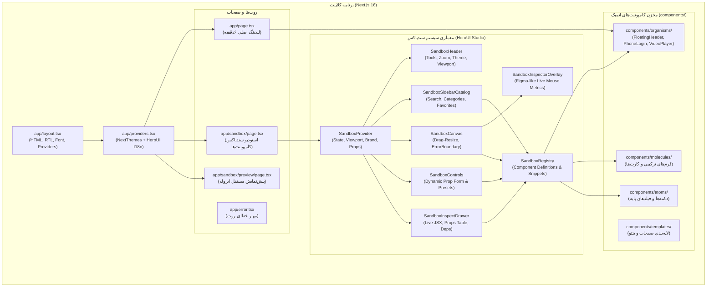
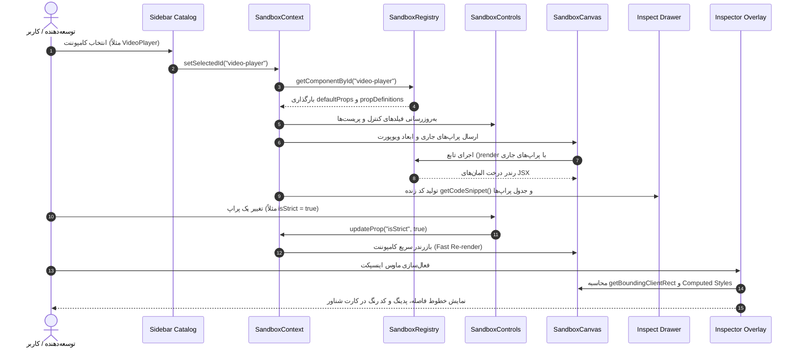
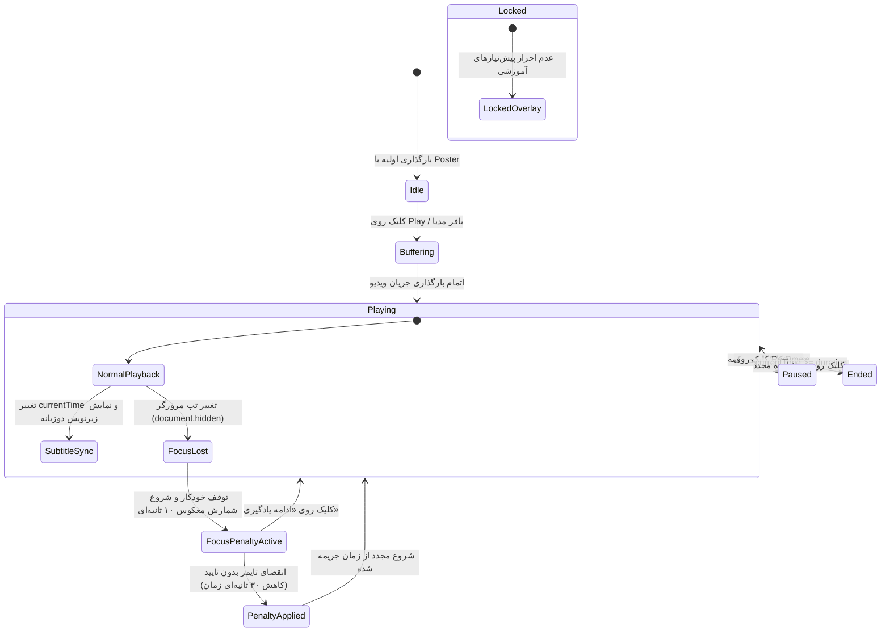
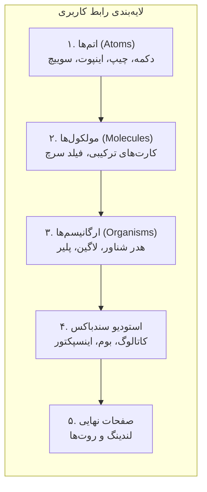
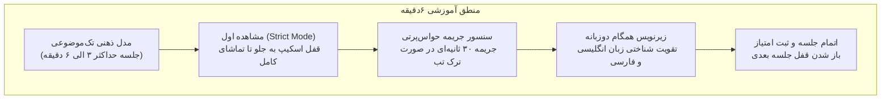
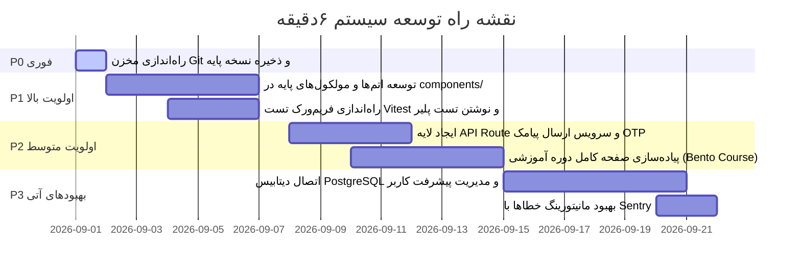

# Project.md — جامع‌ترین سند ارزیابی فنی و معماری پروژه ۶دقیقه (6min)

> **وضعیت سند**: نسخه نهایی و رسمی (Official Technical Audit & Intelligence Document)  
> **روش تحلیل**: تحلیل ایستا و عمیق فایل‌به‌فایل (Static Code Analysis & Structural Audit)  
> **تاریخ نگارش**: ۲۰۲۶-۰۸-۳۱  
> **معیار واقعیت (Source of Truth)**: کد مخزن (Repository Codebase)  

---

## ۱. خلاصه مدیریتی (Executive Summary)

پروژه **۶دقیقه (6min / Six-Minute Micro-Learning System)** یک وب‌اپلیکیشن مدرن آموزش خرد (Micro-Learning) و سکوی توسعه کامپوننت‌های فرانت‌اند است که بر پایه **Next.js 16 (App Router)**، **React 19**، فریم‌ورک کامپوننت‌های **HeroUI v3 (v3.2.4)**، موتور استایل‌دهی **Tailwind CSS v4** و **TypeScript** توسعه یافته است.

هسته مرکزی پروژه در وضعیت فعلی بر رویکرد **توسعه اتمیک (Atomic Design)** و **سندباکس‌محور (Sandbox-First Architecture)** استوار است. این پروژه مجهز به یک استودیو اختصاصی بازرسی و آزمایش کامپوننت‌ها به نام **HeroUI Sandbox Studio** (واقع در مسیر `/sandbox`) است که قابلیت‌هایی نظیر شبیه‌سازی ویوپورت‌های استاندارد (Mobile 375px، Tablet 768px، Desktop 1200px، Full 100%)، آزمایش ۷ پالت رنگی برندی مبتنی بر فضای رنگی **OKLCH**، دستکاری زنده پراپ‌ها (Dynamic Props Control)، دراور بازرسی سورس و تولید لحظه‌ای کدهای JSX، و یک ابزار پیشرفته بازرسی زنده المان‌ها به سبک فیگما (**Figma-like Live Inspector Overlay**) با محاسبه لحظه‌ای ابعاد، فواصل، پدینگ‌ها و رنگ‌ها را در اختیار توسعه‌دهندگان قرار می‌دهد.

پروژه برای زبان فارسی و چیدمان راست‌چین (**RTL**) با وب‌فونت متغیر **ایران‌یکان X متغیر (`IRANYekanXVF`)**، فعال‌سازی ویژگی‌های OpenType نظیر `ss02` (اعداد فارسی سراسری) و `ss03` (اعداد هم‌عرض در `.font-tabular`)، و ایزوله‌سازی دقیق فیلدهای انگلیسی و کدهای LTR بهینه‌سازی کامل شده است.

---

## ۲. هدف پروژه (Project Purpose)

1. **سامانه یادگیری فشرده و متمرکز ۶ دقیقه‌ای**: ایجاد زیرساخت آموزش روزانه با تمرکز بالا بر مدل‌های ذهنی تک‌موضوعی بدون ایجاد خستگی شناختی در کاربر.
2. **پخش هوشمند مدیا با گیمیفیکیشن و تمرکزسنج**: پیاده‌سازی ارگانیسم‌های پیشرفته چندرسانه‌ای مانند `VideoPlayer` مجهز به زیرنویس دوزبانه همگام، حالت مشاهده اول سفت‌وسخت (**Strict Mode** جهت جلوگیری از اسکیپ به جلو در بار اول مشاهده)، مکانیزم جریمه حواس‌پرتی (**Focus Penalty** در صورت ترک تب یا عدم فعالیت با بازگرداندن ۳۰ ثانیه‌ای ویدیو)، و افکت‌های بصری فلوئید گلس (**Fluid Glass**).
3. **محیط توسعه و آزمایشگاهی ایزوله کامپوننت‌ها (Component Workbench)**: حذف نیاز به ابزارهای سنگین شخص ثالث و ارائه یک استودیوی تعاملی اختصاصی با HeroUI v3 و Tailwind v4 جهت پیاده‌سازی، اعتبارسنجی ریسپانسیو و RTL، و تست استیت‌های مختلف قبل از استقرار در صفحات نهایی.

---

## ۳. وضعیت فعلی پروژه (Current State)

| شاخص | وضعیت واقعی مخزن | توضیحات فنی |
| :--- | :--- | :--- |
| **نوع ساختار** | فرانت‌اند مستقل (Client-Side Modular App) | رابط کاربری و استودیو سندباکس به صورت کامل پیاده‌سازی شده است. |
| **لایه بک‌اند / سرور** | وجود ندارد (Not Applicable) | هیچ مسیر API (`app/api`) یا سرور مستقلی در مخزن وجود ندارد. |
| **پایگاه داده / ORM** | وجود ندارد (Not Applicable) | دیتابیس، مدل‌ها و میگریشن‌ها در مخزن تعریف نشده‌اند. |
| **احراز هویت** | ماک‌آپ کلاینتی (Client UI Mockup) | فرم ورود شماره موبایل و منوی کاربری صرفاً رابط بصری هستند. |
| **سیستم تست خودکار** | فاقد تست (No Automated Tests) | هیچ فریم‌ورک تستی (Jest/Vitest/Playwright) پیکربندی نشده است. |
| **پایداری کامپایل** | تایید شده (Type Check Passed) | اجرای `npx tsc --noEmit` با کد خروجی `0` بدون هیچ خطای تایپ سپری شد. |
| **وضعیت گیت** | بدون مخزن گیت (Not a Git Repository) | پوشه `.git` در دایرکتوری پروژه ایجاد نشده است. |

---

## ۴. ساختار کامل درخت مخزن (Repository Tree Structure)

```text
f:/6min/6min/
├── .agents/                                # منابع و اسکیل‌های ایجنت هوش مصنوعی
│   ├── fonts/                              # اسناد و راهنماهای فونت ایران‌یکان X
│   │   ├── IranYekanX Help.html            # راهنمای رسمی اوپن‌تایپ و وریبل فونت
│   │   ├── IRANYekanXV test.html           # نمونه آزمایشی فونت
│   │   └── README.md                       # راهنمای پارامترهای وریبل فونت
│   ├── skills/                             # تعریف مهارت‌های HeroUI React
│   │   └── heroui-react/
│   │       ├── scripts/                    # اسکریپت‌های دریافت مستندات و سورس کامپوننت‌ها
│   │       │   ├── get_component_docs.mjs
│   │       │   ├── get_docs.mjs
│   │       │   ├── get_source.mjs
│   │       │   ├── get_styles.mjs
│   │       │   ├── get_theme.mjs
│   │       │   └── list_components.mjs
│   │       ├── LICENSE.txt
│   │       └── SKILL.md
│   ├── llmherouisrc.md
│   └── mcp_config.json
├── .cursor/                                # پیکربندی اختصاصی ادیتور Cursor
│   └── mcp.json                            # تعریف MCP سرور @heroui/react-mcp
├── .heroui-docs/                           # کش آفلاین مستندات رسمی HeroUI v3 (react)
├── .vscode/                                # تنظیمات اختصاصی VSCode
│   └── settings.json                       # تنظیم مسیر TypeScript SDK
├── app/                                    # صفحات و روت‌های Next.js 16 App Router
│   ├── error.tsx                           # کامپوننت Error Boundary کلاینتی صفحه
│   ├── layout.tsx                          # لی‌اوت اصلی HTML با RTL، تم و متادیتا
│   ├── page.tsx                            # صفحه اصلی لندینگ معرفی ۶دقیقه
│   ├── providers.tsx                       # کانتکست‌های NextThemesProvider و I18nProvider
│   └── sandbox/                            # ماژول استودیو سندباکس کامپوننت‌ها
│       ├── page.tsx                        # صفحه اصلی استودیو سندباکس
│       └── preview/
│           └── page.tsx                    # روت ایزوله پیش‌نمایش مستقل کامپوننت‌ها
├── components/                             # ساختار کامپوننت‌های اتمیک و سندباکس
│   ├── atoms/                              # پوشه اتم‌های پایه (در حال حاضر خالی)
│   ├── molecules/                          # پوشه مولکول‌ها و فرم‌های ترکیبی (در حال حاضر خالی)
│   ├── organisms/                          # ارگانیسم‌های توسعه داده شده
│   │   ├── floating-header.tsx             # هدر شناور شیشه‌ای با منوی پروفایل و ریسپانسیو
│   │   ├── phone-login.tsx                 # فرم مینیمال ورود با شماره موبایل و ولیدیشن
│   │   └── video-player.tsx                # ویدیو پلیر هوشمند ۶۸۶ خطی با سنسور تمرکز و زیرنویس
│   ├── sandbox/                            # ماژول‌های فنی و UI سندباکس
│   │   ├── sandbox-canvas.tsx              # بوم مرکزی رندر، تغییر اندازه درگ و مدیریت خطا
│   │   ├── sandbox-context.tsx             # مدیریت استیت سراسری سندباکس و LocalStorage
│   │   ├── sandbox-controls.tsx            # پنل دستکاری پویا و پریست‌های پراپ‌ها
│   │   ├── sandbox-header.tsx              # هدر نوار ابزار، پالت رنگ، زوم و ویوپورت
│   │   ├── sandbox-inspect-drawer.tsx      # دراور بازرسی، جدول پراپ و کپی کد JSX
│   │   ├── sandbox-inspector-overlay.tsx   # اینسپکتور زنده ماوس سبک فیگما (Figma Overlay)
│   │   ├── sandbox-registry.tsx            # رجیستری متادیتا، پراپ‌ها و رندر کامپوننت‌ها
│   │   ├── sandbox-sidebar-catalog.tsx     # سایدبار کاتالوگ، جستجوی سریع و علاقه‌مندی‌ها
│   │   └── sandbox-types.ts                # تعاریف تایپ‌های داده سندباکس
│   └── templates/                          # قالب‌های کامل صفحات (در حال حاضر خالی)
├── config/                                 # پیکربندی‌های استاتیک فرانت‌اند
│   ├── fonts.ts                            # تعاریف فونت‌های Next.js Google Fonts (Inter / Fira Code)
│   └── site.ts                             # متادیتای سایت، عناوین و لینک‌های ناوبری
├── public/                                 # دارایی‌های استاتیک عمومی
│   ├── favicon.ico                         # آیکون وب‌سایت
│   └── fonts/                              # فایل‌های وب‌فونت ایران‌یکان X
│       ├── IRANYekanXVF.woff               # وریبل فونت فرمت WOFF
│       ├── IRANYekanXVF.woff2              # وریبل فونت مدرن WOFF2
│       └── staticfonts/                    # فونت‌های استاتیک فال‌بک
│           ├── IRANYekanX-Bold.woff        # نسخه Bold
│           └── IRANYekanX-Regular.woff     # نسخه Regular
├── styles/                                 # استایل‌های سراسری پروژه
│   └── globals.css                         # ایمپورت Tailwind v4، HeroUI styles، متغیرهای OKLCH و وریبل فونت
├── types/                                  # تایپ‌های عمومی TypeScript
│   └── index.ts                            # تایپ IconSvgProps
├── .gitignore                              # الگوهای نادیده‌گیری گیت
├── .npmrc                                  # تنظیم lockfile در npm
├── AGENTS.md                               # راهنمای ایجنت‌ها و ایندکس مستندات HeroUI v3
├── CLAUDE.md                               # دستورالعمل‌های کامند لاین و راهنمای ایجنت Claude
├── eslint.config.mjs                       # پیکربندی Flat Config نسخه ۹ لینتر ESLint
├── mcp_config.json                         # پیکربندی MCP سرور HeroUI React
├── next-env.d.ts                           # تعاریف تایپ محیط Next.js
├── next.config.mjs                         # تنظیمات بیلد Next.js
├── package.json                            # مانیفست پکیج‌ها و اسکریپت‌های اجرایی
├── package-lock.json                       # قفل نسخه‌های پکیج‌های NPM
├── postcss.config.mjs                      # پیکربندی PostCSS برای @tailwindcss/postcss
├── skills-lock.json                        # متادیتای قفل اسکیل‌های هوش مصنوعی
├── tsconfig.json                           # پیکربندی کامپایلر تایپ‌اسکریپت
├── Workflow.md                             # سند استاندارد قوانین توسعه کامپوننت و Definition of Done
└── README.md                               # سند راهنمای اولیه قالب Next.js و HeroUI
```

---

## ۵. پشته فناوری (Technology Stack)



### جدول تفصیلی تکنولوژی‌ها

| رده فناوری | نام پکیج / ابزار | نسخه دقیق | نقش در پروژه | محل استفاده | وضعیت استفاده واقعی |
| :--- | :--- | :--- | :--- | :--- | :--- |
| **Framework** | `next` | `16.2.6` | فریم‌ورک اصلی Full-Stack / App Router | روت‌های `app/` | کاملاً فعال |
| **UI Library** | `react` / `react-dom` | `19.2.6` | موتور رندر کامپوننت‌های فرانت‌اند | تمام فایل‌های JSX/TSX | کاملاً فعال |
| **Component Kit** | `@heroui/react` | `3.2.4` | کیت کامپوننت‌های رسمی بدون پرووایدر (Compound) | دکمه‌ها، چیپ‌ها، اسلایدر، اسپینر و اینپوت‌ها | کاملاً فعال |
| **Styles Engine** | `@heroui/styles` | `3.2.4` | استایل‌های پایه و توکن‌های BEM هیرویوآی | `styles/globals.css` | کاملاً فعال |
| **CSS Framework** | `tailwindcss` | `4.1.11` | فریم‌ورک کلاس‌های کاربردی نسل ۴ | `styles/globals.css`, `postcss.config.mjs` | کاملاً فعال |
| **PostCSS Plugin** | `@tailwindcss/postcss` | `4.1.11` | کامپایلر PostCSS برای Tailwind v4 | `postcss.config.mjs` | کاملاً فعال |
| **Theme Engine** | `next-themes` | `0.4.6` | مدیریت تم دارک / لایت و کلاس `dark` | `app/providers.tsx`, `floating-header.tsx`, `sandbox-header.tsx` | کاملاً فعال |
| **Icons Library** | `lucide-react` | `^1.31.0` | مجموعه آیکون‌های وکتور مینیمال | هدر، ویدیو پلیر، سایدبار و دکمه‌ها | کاملاً فعال |
| **Localization** | `intl-messageformat` | `10.7.16` | فرمت‌بندی پیام‌های بین‌المللی | وابستگی داخلی `@heroui/react` | فعال به عنوان Dependency |
| **Class Merger** | `clsx` | `2.1.1` | ترکیب شرطی کلاس‌های CSS | `app/layout.tsx` | کاملاً فعال |
| **Type Checker** | `typescript` | `5.6.3` | اعتبارسنجی استاتیک انواع داده | کل فایل‌های `.ts` و `.tsx` | کاملاً فعال |
| **Linter Engine** | `eslint` | `9.25.1` | لینتر کد و بررسی استانداردهای پروژه | `eslint.config.mjs` | کاملاً فعال |
| **Code Formatter**| `prettier` | `3.5.3` | یکدست‌سازی فرمت کدها | پیکربندی ESLint | کاملاً فعال |

---

## ۶. تحلیل وابستگی‌ها (Dependencies Audit)

### وابستگی‌های عملیاتی (`dependencies`)

| پکیج | نسخه | کاربرد دقیق | ضرورت (Critical) | ریسک / توضیحات |
| :--- | :--- | :--- | :--- | :--- |
| `@heroui/react` | `3.2.4` | کامپوننت‌های تعاملی UI (Button, Chip, Spinner, Avatar, etc.) | حیاتی (P0) | نسخه مدرن v3 با ساختار Compound Components |
| `@heroui/styles` | `3.2.4` | توکن‌ها و تعاریف استایل CSS | حیاتی (P0) | پیش‌نیاز رندر صحیح HeroUI v3 |
| `clsx` | `2.1.1` | ترکیب کلاس‌های رشته‌ای | کم (P3) | در `app/layout.tsx` استفاده شده است |
| `intl-messageformat` | `10.7.16` | قالب‌بندی متون محلی | متوسط (P2) | برای پشتیبانی از تاریخ و اعداد محلی |
| `lucide-react` | `^1.31.0` | آیکون‌های رابط کاربری | حیاتی (P1) | استفاده گسترده در سراسر کامپوننت‌ها |
| `next` | `16.2.6` | فریم‌ورک Next.js | حیاتی (P0) | هسته اپلیکیشن |
| `next-themes` | `0.4.6` | سوئیچ تم تاریک و روشن | حیاتی (P1) | یکپارچه شده با کانتکست سندباکس و هدر |
| `react` | `19.2.6` | کتابخانه اصلی ری‌اکت | حیاتی (P0) | هسته رابط کاربری |
| `react-dom` | `19.2.6` | اتصال ری‌اکت به DOM مرورگر | حیاتی (P0) | هسته رابط کاربری |

### وابستگی‌های توسعه (`devDependencies`)

| پکیج | نسخه | کاربرد | وضعیت استفاده |
| :--- | :--- | :--- | :--- |
| `tailwindcss` | `4.1.11` | موتور Tailwind v4 | کاملاً فعال در پروسه ساخت استایل |
| `@tailwindcss/postcss` | `4.1.11` | پلاگین PostCSS | فعال در `postcss.config.mjs` |
| `tailwind-variants` | `3.3.0` | ساخت واریانت‌های کلاسی | نصب شده (آماده استفاده در طراحی کامپوننت‌ها) |
| `@types/node`, `@types/react`, `@types/react-dom` | سازگار با v19/v20 | تعاریف تایپ‌های سیستم | فعال |
| مجموعه `eslint` و پلاگین‌های مرتبط | سازگار با ESLint 9 | تحلیل کدهای TypeScript، JSX و استانداردهای A11y | فعال در `eslint.config.mjs` |

---

## ۷. معماری واقعی نرم‌افزار (Architecture)

معماری پروژه مبتنی بر الگوی **Component-Driven Development (CDD)** به همراه متدولوژی **Atomic Design** و لایه‌بندی فرانت‌اند ماژولار است:



---

## ۸. دیاگرام‌های جریان داده و تعاملات (Interaction & Data Flow Diagrams)

### ۱. جریان اجرای سیستم سندباکس و رندر پویا (Sandbox Workflow)



### ۲. دیاگرام ماشین حالت ویدیو پلیر هوشمند (`VideoPlayer` State Machine)



---

## ۹. تحلیل دایرکتوری به دایرکتوری (Directory-by-Directory Analysis)

| مسیر پوشه | مسئولیت و هدف | فایل‌های شاخص | وابستگی‌ها | وضعیت و نکات فنی |
| :--- | :--- | :--- | :--- | :--- |
| `app/` | روت‌های اصلی وب‌اپلیکیشن | `layout.tsx`, `page.tsx`, `providers.tsx`, `error.tsx` | `@heroui/react`, `next-themes`, `config/site.ts` | استفاده کامل از Next.js 16 App Router |
| `app/sandbox/` | مسیرهای دسترسی به استودیوی سندباکس | `page.tsx`, `preview/page.tsx` | `components/sandbox/*` | صفحه اصلی سندباکس و پیش‌نمایش مستقل |
| `components/atoms/` | اتم‌ها و عناصر پایه UI | *(در حال حاضر خالی)* | `@heroui/react` | آماده برای تعریف کامپوننت‌های پایه سفارشی |
| `components/molecules/` | ترکیب اتم‌ها و کارت‌های فرم | *(در حال حاضر خالی)* | `components/atoms/` | آماده برای توسعه طبق متدولوژی اتمیک |
| `components/organisms/` | بخش‌های مستقل و پیشرفته رابط کاربری | `floating-header.tsx`, `phone-login.tsx`, `video-player.tsx` | `@heroui/react`, `lucide-react`, `next-themes` | پیاده‌سازی شده با بالاترین استانداردهای بصری و تعاملی |
| `components/sandbox/` | موتور و معماری داخلی استودیو سندباکس | ۹ فایل تایپ‌اسکریپت سندباکس | `@heroui/react`, `lucide-react`, `next-themes` | ماژول کامل با اینسپکتور زنده، کاتالوگ و کنترلرها |
| `components/templates/` | قالب‌های کامل صفحات | *(در حال حاضر خالی)* | `components/organisms/` | آماده برای چیدمان‌های Bento و Workspace |
| `config/` | متادیتا و پیکربندی‌های استاتیک | `fonts.ts`, `site.ts` | `next/font/google` | حاوی اطلاعات برند، ناوبری و متادیتای سایت |
| `public/fonts/` | وب‌فونت‌های محلی پروژه | `IRANYekanXVF.woff2`, static fonts | CSS `@font-face` | فونت ایران‌یکان X متغیر با پشتیبانی از ویژگی‌های OpenType |
| `styles/` | تنظیمات CSS و توکن‌های طراحی | `globals.css` | `@heroui/styles`, `tailwindcss` | تعریف رنگ‌های OKLCH، کلاس‌های گلس و استایل‌های عمومی |
| `types/` | تایپ‌های سراسری تایپ‌اسکریپت | `index.ts` | `react` (SVGProps) | تعاریف عمومی اینترفیس‌ها |
| `.agents/` | اسکیل‌ها و ابزارهای توسعه هوش مصنوعی | `heroui-react/SKILL.md`, scripts | Node.js scripts | اسکریپت‌های دریافت آفلاین داکیومنت هیرویوآی |

---

## ۱۰. تحلیل فایل‌به‌فایل سورس‌کد (File-Level Analysis)

### ۱. فایل‌های لایه روت و پیکربندی برنامه (`app/`)

#### [app/layout.tsx](file:///f:/6min/6min/app/layout.tsx)
* **هدف و عملکرد**: روت لی‌اوت اصلی برنامه. تنظیم تگ‌های `<html>` با `dir="rtl"` و `lang="fa"`، متادیتای سئو و OpenGraph، پیکربندی Viewport و تم دارک پیش‌فرض.
* **ایمپورت‌ها**: `@/styles/globals.css`, `next`, `clsx`, `./providers`, `@/config/site`.
* **نقش معماری**: Entry Point اصلی رابط کاربری.
* **ویژگی‌های خاص**: اعمال کلاس‌های `overflow-hidden`, `bg-background`, `text-foreground` و مهار Hydration Warning.

#### [app/providers.tsx](file:///f:/6min/6min/app/providers.tsx)
* **هدف و عملکرد**: ارائه‌دهنده پرووایدرهای سراسری کلاینت. یکپارچه‌سازی `NextThemesProvider` (مدیریت تم) و `I18nProvider` متعلق به هیرویوآی با لوکال `fa-IR-u-ca-persian`.
* **ویژگی‌های خاص**: در HeroUI v3 نیازی به `<HeroUIProvider>` نیست و فقط I18nProvider برای محاسبات تقویم و زبان قرار داده شده است.

#### [app/page.tsx](file:///f:/6min/6min/app/page.tsx)
* **هدف و عملکرد**: صفحه لندینگ اصلی و معرفی پروژه ۶دقیقه. شامل پس‌زمینه گرافیکی با گوی‌های نوری بلور شده، فراخوانی `FloatingHeader`، کارت‌های سه‌گانه مسیر توسعه اتمیک، و دکمه هدایت به استودیوی سندباکس.

#### [app/error.tsx](file:///f:/6min/6min/app/error.tsx)
* **هدف و عملکرد**: مهارکننده سراسری خطای روت‌های Next.js (Error Boundary) با دکمه تعاملی «تلاش مجدد» و ثبت خطا در کنسول.

#### [app/sandbox/page.tsx](file:///f:/6min/6min/app/sandbox/page.tsx)
* **هدف و عملکرد**: صفحه استودیوی سندباکس کامپوننت‌ها (`/sandbox`). ترکیب ۵ بخش اصلی استودیو شامل `SandboxHeader`, `SandboxSidebarCatalog`, `SandboxCanvas`, `SandboxControls` و `SandboxInspectDrawer` درون `SandboxProvider`.

#### [app/sandbox/preview/page.tsx](file:///f:/6min/6min/app/sandbox/preview/page.tsx)
* **هدف و عملکرد**: روت ایزوله و مستقل پیش‌نمایش کامپوننت با خواندن پارامترهای آدرس (`id` و `brand`) جهت تست مستقیم یا استفاده در آی‌فریم.

---

### ۲. فایل‌های ارگانیسم‌های توسعه‌یافته (`components/organisms/`)

#### [components/organisms/floating-header.tsx](file:///f:/6min/6min/components/organisms/floating-header.tsx)
* **هدف**: هدر شناور مدرن کپسولی با افکت شیشه‌ای و ناوبری ریسپانسیو.
* **امکانات**:
  * فاصله از بالا با انیمیشن تغییر ابعاد هنگام اسکرول (**Scroll Morphing** با منحنی `cubic-bezier(0.23, 1, 0.32, 1)`).
  * نشانگر برند با چیپ PRO و آیکون شناور.
  * منوی ناوبری دسکتاپ و دراور کشویی متحرک موبایل.
  * سوییچر تم کپسولی لایت و دارک.
  * بخش حساب کاربری با آواتار، مدال رول کاربری (`ShieldCheck`) و دراپ‌داون شیشه‌ای با گزینه‌های داشبورد، گواهینامه‌ها، تنظیمات و خروج.

#### [components/organisms/phone-login.tsx](file:///f:/6min/6min/components/organisms/phone-login.tsx)
* **هدف**: فرم مینیمال ورود و ثبت‌نام با شماره تلفن همراه بدون کادرهای زائد (Cardless Design).
* **امکانات**:
  * توابع تبدیل ارقام فارسی و انگلیسی (`toPersianDigits` و `toEnglishDigits`).
  * اعتبارسنجی زنده شماره موبایل‌های ایران (شروع با `09` و دقیقاً ۱۱ رقم).
  * پیشوند `+۹۸` با ایزولاسیون جهت `dir="ltr"` و فونت مونو.
  * نشانگر موفقیت با آیکون تایید سبز رنگ `ShieldCheck`.
  * دکمه ورود مجهز به وضعیت لودینگ و اسپینر هیرویوآی.

#### [components/organisms/video-player.tsx](file:///f:/6min/6min/components/organisms/video-player.tsx)
* **هدف**: پیشرفته‌ترین ارگانیسم پروژه (۶۸۶ خط کد)؛ پلیر ویدیویی ماژولار و هوشمند با گیمیفیکیشن و تمرکزسنج.
* **امکانات شاخص**:
  * **استایل بصری**: انحنای پیوسته گوشه‌ها به سبک اپل iOS (`.rounded-ios-player` با `corner-smoothing: 60%`) و حاشیه نوری درخشان (`.glass-rim`).
  * **تایم‌لاین تعاملی**: نوار پیشرفت سفارشی‌سازی شده با `@heroui/react` `ProgressBar` و انکر قطعی چپ برای جلوگیری از معکوس شدن در حالت RTL، با قابلیت نمایش زمان در هاور (Hover Scrubbing Preview).
  * **Strict Mode**: جلوگیری از جلو زدن ویدیو در اولین بار مشاهده تا سقف ثانیه‌های تماشا شده (`maxWatchedTime`).
  * **Focus Penalty**: حسگر عدم تمرکز کاربر بر پایه رویداد `visibilitychange`؛ در صورت رفتن به تب دیگر، پخش متوقف شده و تایمر ۱۰ ثانیه‌ای فعال می‌شود که در صورت عدم تایید، زمان پخش ۳۰ ثانیه به عقب بازمی‌گردد.
  * **زیرنویس هوشمند دوزبانه**: نمایش لایه متنی ترجمه فارسی و متن اصلی انگلیسی همگام با `currentTime`.
  * **ماشین وضعیت‌های کامل**: حالت بافرینگ (`isBuffering`)، حالت قفل جلسه (`isLocked`) با پیام پیش‌نیاز، اعلان بازگشت مجدد (`enableReentry`) و صفحه پایانی تبریک اتمام درس.
  * **کنترل‌ها**: تغییر سرعت پخش (1x, 1.25x, 1.5x, 2x)، قطع و وصل صدا، دکمه فول‌اسکرین با HTML5 Fullscreen API.

---

### ۳. فایل‌های موتور استودیو سندباکس (`components/sandbox/`)

| نام فایل | نقش و مسئولیت فنی | خطوط کلیدی و لاجیک |
| :--- | :--- | :--- |
| **`sandbox-types.ts`** | تعاریف ساختار داده‌های کامپوننت، پراپ‌ها، دسته‌ها و پالت‌ها | `SandboxComponent`, `PropDefinition`, `BrandPreset` |
| **`sandbox-context.tsx`** | کانتکست سراسری مدیریت استیت سندباکس و همگام‌سازی با `localStorage` | ذخیره علاقه‌مندی‌ها، تغییرات زنده پراپ‌ها، زوم و ویوپورت |
| **`sandbox-registry.tsx`** | رجیستری مرکزی ثبت کامپوننت‌ها همراه با متادیتا و اسنیپت‌های کپی | ثبت `VideoPlayer`, `PhoneLogin`, `FloatingHeader` |
| **`sandbox-header.tsx`** | نوار ابزار بالای استودیو | سوئیچ ۷ پالت رنگی OKLCH، کنترل زوم ۵۰٪ تا ۱۵۰٪، تغییر ویوپورت |
| **`sandbox-sidebar-catalog.tsx`** | سایدبار کاتالوگ کامپوننت‌ها | میانبر جستجوی سریع `Ctrl+K`، تب‌های دسته‌بندی و نشان کردن علاقه‌مندی‌ها |
| **`sandbox-canvas.tsx`** | بوم شبیه‌ساز با ابعاد ایزوله | ریسایز تعاملی با درگ چپ و راست، پس‌زمینه‌های شطرنجی/نقاط/میلی‌متری و Error Boundary |
| **`sandbox-controls.tsx`** | پنل سمت چپ تولید داینامیک فرم پراپ‌ها | تبدیل تایپ‌های boolean, select, string, number به ورودی‌های تعاملی |
| **`sandbox-inspect-drawer.tsx`** | دراور پایینی تحلیل کد و مشخصات | تب‌های Live JSX، جدول پراپ‌ها، وابستگی‌های HeroUI و دکمه‌های کپی |
| **`sandbox-inspector-overlay.tsx`** | اینسپکتور زنده المان‌ها به سبک فیگما (۴۴۹ خط) | محاسبه دقیق Bounding Box، فواصل ۴ جهته، پدینگ، ردیوس، رنگ و فونت همراه با Pin |

---

### ۴. فایل‌های پیکربندی و استایل‌ها

#### [styles/globals.css](file:///f:/6min/6min/styles/globals.css)
* **تحلیل خط‌به‌خط**:
  * خطوط ۱ تا ۴: ایمپورت `tailwindcss` و `@heroui/styles` و تعریف `@custom-variant dark`.
  * خطوط ۱۱ تا ۳۵: تعریف `@font-face` وریبل و استاتیک ایران‌یکان X (`IRANYekanXVF.woff2`, `IRANYekanXVF.woff`, static Regular & Bold).
  * خطوط ۳۷ تا ۴۰: اتصال فونت‌ها به متغیرهای تم Tailwind v4 (`--font-sans`, `--font-mono`).
  * خطوط ۴۴ تا ۷۴: تنظیم `font-feature-settings: "ss02"` برای فارسی‌سازی ارقام در سطح کل صفحه و استثنا کردن فیلدهای `[dir="ltr"]`, `email`, `tel`, `password` و `font-mono`.
  * خطوط ۶۰ تا ۶۳: کلاس اختصاصی `.font-tabular` با فعال‌سازی `ss02, ss03` و `tabular-nums` برای اعداد جداول و قیمت‌ها.
  * خطوط ۱۰۲ تا ۱۶۵: تنظیمات ۷ پالت رنگی برندی HeroUI با متغیرهای OKLCH (`default`, `emerald`, `indigo`, `violet`, `amber`, `rose`, `cyan`).
  * خطوط ۱۷۲ تا ۲۰۵: کلاس شیشه‌ای نوری `.glass-rim` با تکنیک CSS Masking و گرادیانت.
  * خطوط ۲۰۹ تا ۲۱۸: کلاس انحنای پیوسته `.rounded-ios-player` با `-webkit-corner-smoothing: 0.6`.

#### [config/site.ts](file:///f:/6min/6min/config/site.ts)
* تعاریف نام برند، توضیحات، آیتم‌های منوی ناوبری و لینک‌های داکیومنت هیرویوآی.

#### [config/fonts.ts](file:///f:/6min/6min/config/fonts.ts)
* بارگذاری فونت‌های Inter و Fira Code از Google Fonts. *(نکته: در حال حاضر در `globals.css` با فونت‌های لوکال ایران‌یکان X جایگزین شده‌اند).*

---

## ۱۱. بخش فرانت‌اند (Frontend Audit)



* **طراحی واکنش‌گرا (Responsive Design)**: پشتیبانی کامل از عرض ۳۷۵ پیکسل (موبایل‌های استاندارد)، ۷۶۸ پیکسل (تبلت‌ها)، ۱۲۰۰ پیکسل (دسکتاپ) و ۱۰۰٪. استفاده پیشرفته از ویژگی‌های کانتینر کوئری (`@container` و `@[640px]:...` / `@[768px]:...`).
* **چیدمان و بومی‌سازی راست‌چین (RTL)**: رعایت اکید CSS Logical Properties (`ms-*`, `me-*`, `ps-*`, `pe-*`, `text-start`, `rounded-s-*`).
* **مدیریت تم (Theme & Dark Mode)**: پشتیبانی دو لایه؛ سوییچ تم لایت/دارک سراسری با کلاس `.dark` و انتخاب همزمان ۷ تم رنگی برندی با اتریبیوت `data-brand`.
* **دسترس‌پذیری (Accessibility)**: رعایت استانداردهای کیت HeroUI و React Aria شامل پشتیبانی کامل از رویدادهای کیبورد، فوکوس بصری، شناسه المان‌ها و خصوصیات `aria-label`.

---

## ۱۲. بخش بک‌اند (Backend Audit)

> **وضعیت**: **Not Applicable (غیر قابل اعمال در نسخه فعلی)**  
> **دلیل مستند**: پروژه در وضعیت فعلی صرفاً یک وب‌اپلیکیشن کلاینت‌محور (Client-Side Application) و کیت توسعه کامپوننت‌های فرانت‌اند است. هیچ سرور Node.js مستقل، فایل Express/Fastify، یا Server Action و Route Handler در پوشه `app/api/` پیاده‌سازی نشده است.

---

## ۱۳. مستندات API (API Documentation)

> **وضعیت**: **Not Applicable (فاقد اندپوینت API)**  
> **دلیل مستند**: هیچ فایل روت API (مانند `app/api/**/route.ts`) در ساختار دایرکتوری مخزن وجود ندارد. کلیه تعاملات و اعتبارسنجی‌ها (مانند ارسال فرم در `PhoneLogin` یا رویدادهای `VideoPlayer`) از طریق Callback Functionهای Props کلاینتی مدیریت می‌شوند.

---

## ۱۴. پایگاه داده و مدل‌ها (Database & ORM)

> **وضعیت**: **Not Applicable (فاقد پایگاه داده)**  
> **دلیل مستند**: در کدهای پروژه هیچ‌گونه پایگاه داده (مانند PostgreSQL, MySQL, MongoDB, SQLite) یا نگاشت شیء-رابطه‌ای (مانند Prisma, Drizzle, TypeORM, Mongoose) پیکربندی نشده است. ذخیره‌سازی وضعیت‌های ماندگار کاربر (مانند لیست کامپوننت‌های نشان‌شده) از طریق `window.localStorage` با کلید `heroui_sandbox_favs` انجام می‌پذیرد.

---

## ۱۵. احراز هویت و دسترسی‌ها (Authentication & Authorization)

* **وضعیت فعلی**: احراز هویت صرفاً در سطح **رابط کاربری ماک‌آپ (UI Simulation)** وجود دارد.
* **کامپوننت‌های احراز هویت**:
  1. `PhoneLogin` (`components/organisms/phone-login.tsx`): اعتبارسنجی فرمت ارقام موبایل و ارسال داده از طریق پراپ `onSubmit`.
  2. `FloatingHeader` (`components/organisms/floating-header.tsx`): پراپ `isLoggedIn` (پیش‌فرض `true`) برای تغییر وضعیت بین کاربر لاگین‌شده (نمایش آواتار علی رضوانی با رول دانشجوی پیشرفته) و کاربر مهمان (دکمه ورود/ثبت‌نام).
* **نقاط فاقد پیاده‌سازی**: سیستم توکن‌های JWT، کوکی‌های نشست (Session Cookies)، سرویس‌های پیامکی ارسال کد تایید OTP، و رول‌بندی بک‌اند هنوز به پروژه اضافه نشده‌اند.

---

## ۱۶. سرویس‌های خارجی (External Services)

| سرویس / منبع | نحوه اتصال | محل استفاده | ریسک و نحوه مدیریت خطا |
| :--- | :--- | :--- | :--- |
| **Unsplash Images** | لود مستقیم تصاویر پوستر از CDN | `components/organisms/video-player.tsx`, `sandbox-registry.tsx` | وابستگی به اینترنت؛ در صورت قطعی تصویر لود نمی‌شود اما لایه گرادیانت و بلور جایگزین می‌گردد. |
| **Pravatar CC** | تصویر آواتار تصادفی کاربر | `components/organisms/floating-header.tsx` | فال‌بک نام کاربر به صورت حروف اول (`Avatar.Fallback`) پیاده‌سازی شده است. |
| **Google Fonts** | فونت‌های Inter و Fira Code | `config/fonts.ts` | در حالت عادی بلااستفاده است چون فونت‌های محلی ایران‌یکان X اعمال شده‌اند. |
| **HeroUI MCP Server** | ابزار هوش مصنوعی توسعه هیرویوآی | `mcp_config.json`, `.cursor/mcp.json` | ابزار کمکی توسعه‌دهنده (بدون اثرگذاری در بیلد پروداکشن). |

---

## ۱۷. متغیرهای محیطی (Environment Variables)

> **بررسی امنیتی**: مخزن فاقد فایل‌های `.env`, `.env.local`, `.env.example` یا هرگونه متغیر محیطی حساس است. هیچ رمز عبور، کلید خصوصی یا API Key در کدها هاردکد نشده است.

| نام متغیر | الزامی / اختیاری | مقدار پیش‌فرض | کاربرد | حساسیت |
| :--- | :--- | :--- | :--- | :--- |
| *فاقد متغیر محیطی* | - | - | پروژه کاملاً کلاینتی و بدون نیاز به کلید اجرا می‌شود | خیر |

---

## ۱۸. پیکربندی‌های پروژه (Configuration Files Audit)

| فایل پیکربندی | هدف و نقش | ویژگی‌ها و وضعیت |
| :--- | :--- | :--- |
| **`package.json`** | مانیفست پکیج‌ها | نام پروژه: `next-app-template`، پکیج‌ها با نسخه‌های سازگار Next 16 و React 19 |
| **`tsconfig.json`** | کامپایلر تایپ‌اسکریپت | حالت Strict فعال، ماژول Bundler، مپینگ مسیر `@/*` به `./*` |
| **`next.config.mjs`** | تنظیمات Next.js | شیء خالی `nextConfig = {}` |
| **`postcss.config.mjs`** | پردازنده استایل‌ها | فراخوانی مستقیم پلاگین `@tailwindcss/postcss` |
| **`eslint.config.mjs`** | پیکربندی Flat ESLint 9 | ۱۲۸ خط قوانین مرتب‌سازی ایمپورت‌ها، پراتییر و دسترس‌پذیری |
| **`.gitignore`** | نادیده‌گیری فایل‌ها در گیت | مهار `node_modules`, `.next`, `build`, `.env*`, `.heroui-docs` |
| **`.npmrc`** | رفتار پکیج منیجر | فعال بودن `package-lock=true` |

---

## ۱۹. اسکریپت‌ها و دستورات اجرایی (Scripts & Commands)

```bash
# ۱. اجرای سرور توسعه روی پورت پیش‌فرض ۳۰۰۰
npm run dev

# ۲. اجرای مستقیم استودیو سندباکس روی پورت ۶۰۰۶
npm run sandbox

# ۳. بیلد نهایی بهینه‌سازی شده برای پروداکشن
npm run build

# ۴. اجرای نسخه بیلد شده پروداکشن
npm run start

# ۵. اجرای لینتر و اصلاح خودکار خطاها
npm run lint

# ۶. بررسی استاتیک بدون خطای تایپ‌اسکریپت
npx tsc --noEmit
```

---

## ۲۰. سیستم تست (Testing Audit)

* **وضعیت فعلی**: **فاقد تست‌های خودکار (0% Automated Test Coverage)**.
* **ارزیابی ریسک**:
  * کامپوننت پیچیده‌ای مانند `VideoPlayer` با ماشین وضعیت‌های زمان، بافرینگ، Strict Mode و جریمه فوکوس نیازمند تست‌های واحد (`Unit Tests`) جهت اعتبارسنجی تایمرها و لاجیک‌های رخداد است.
  * توابع کمکی `toPersianDigits` و `toEnglishDigits` در `phone-login.tsx` نیازمند تست واحد جامع برای پوشش کاراکترهای مختلف هستند.
* **پیشنهاد**: استقرار فریم‌ورک **Vitest** به همراه **React Testing Library** برای کامپوننت‌ها.

---

## ۲۱. مدیریت خطا (Error Handling)

1. **سطح روت (Page Level)**: فایل `app/error.tsx` با کامپوننت استاندارد Next.js Error Boundary مجهز به دکمه Reset و پیام خطای فارسی.
2. **سطح بوم سندباکس (Canvas Level)**: کلاس `CanvasErrorBoundary` در `components/sandbox/sandbox-canvas.tsx` که خطاهای رندرینگ ناشی از پراپ‌های نامعتبر را مهار کرده و به جای کرش کردن کل صفحه، پیام خطا و استک لاگ را به صورت تفکیک‌شده نمایش می‌دهد.
3. **سطح فرم‌ها (Input Level)**: اعتبارسنجی زنده شماره تلفن همراه با نمایش پیام خطای شفاف در صورت نامعتبر بودن ارقام.

---

## ۲۲. لاگینگ و مانیتورینگ (Logging & Monitoring)

* **وضعیت**: لاگینگ ساخت‌یافته یا ابزارهای تلمتری خارجی (مانند Sentry, OpenTelemetry, LogRocket) متصل نشده است.
* **لاگ‌های مشاهده شده در کد**:
  * `app/error.tsx:15`: ثبت خطای روت در `console.error(error)`.
  * `components/sandbox/sandbox-registry.tsx:258`: چاپ لاگ سابمیت شماره تلفن در پیش‌نمایش کد JSX (`console.log("Phone:", phone)`).

---

## ۲۳. بازرسی امنیت (Security Audit)

| حوزه امنیتی | وضعیت | ارزیابی و شواهد |
| :--- | :--- | :--- |
| **Secrets & Keys** | پاک (Clean) | هیچ کلید دسترسی، توکن یا رمزی در کدها یافت نشد. |
| **XSS (تزریق اسکریپت)** | امن (Safe) | عدم استفاده از `dangerouslySetInnerHTML`؛ رندرینگ ایمن توسط React 19. |
| **SQL/NoSQL Injection**| فاقد ریسک | عدم وجود پایگاه داده و کوئری‌های سمت سرور. |
| **اعتبارسنجی ورودی** | مناسب در کلاینت | پاکسازی ورودی‌های تلفن در `phone-login.tsx` با فیلتر کاراکترهای غیرعددی (`replace(/\D/g, "")`). |
| **دسترس‌پذیری و فوکوس** | کنترل شده | استفاده از کامپوننت‌های دسترس‌پذیر HeroUI مبتنی بر استانداردهای WAI-ARIA. |

---

## ۲۴. تحلیل عملکرد (Performance Analysis)

* **CSS و استایل‌ها**: استفاده از Tailwind CSS v4 مبتنی بر کامپایلر مدرن Rust بدون کلاس‌های منسوخ شده، حجم باندل CSS بسیار پایین و بهینه‌سازی شده است.
* **مدیریت انیمیشن‌ها**: در HeroUI v3 تمامی انیمیشن‌ها مبتنی بر CSS Transitions و GPU Acceleration (`transform-gpu`, `isolate`) پیاده‌سازی شده و پکیج‌های سنگین مانند `framer-motion` حذف شده‌اند.
* **فونت وب**: وب‌فونت ایران‌یکان X با فرمت مدرن WOFF2 فشرده‌شده و به صورت لوکال با ویژگی `font-display: fallback` لود می‌شود که از بروز پدیده FOIT (پرش متن) جلوگیری می‌کند.
* **بهینه‌سازی هوشمند رندرهای ری‌اکت**: ارگانیسم `VideoPlayer` از هوک‌های `useMemo` و `useCallback` برای محاسبه زیرنویس فعال و جلوگیری از ری‌رندرهای زائد در ثانیه‌های غیرمرتبط بهره می‌برد.

---

## ۲۵. کیفیت کد و استانداردهای توسعه (Code Quality & Clean Code)

* **ماژولاریتی و تفکیک وظایف (Separation of Concerns)**: بسیار مطلوب؛ فایل‌های بخش سندباکس (`components/sandbox/*`) کاملاً تفکیک شده و وظایف Context، Canvas، Controls، Header و Inspector کاملاً مستقل هستند.
* **نام‌گذاری و خوانایی**: نام متغیرها، توابع و کامپوننت‌ها کاملاً شفاف و خودتوضیح (Self-explanatory) هستند و توضیحات فارسی در بالای بخش‌های حساس قرار دارند.
* **تایپ‌سیفتی (Type Safety)**: تایپ‌اسکریپت به صورت کامل و بدون خطای کامپایل اعمال شده است. تمام پراپ‌ها دارای اینترفیس اختصاصی هستند.

---

## ۲۶. بدهی فنی و کدهای زائد (Technical Debt & Dead Code)

1. **فایل بلااستفاده `config/fonts.ts`**: فونت‌های Inter و Fira Code تعریف شده‌اند اما در `styles/globals.css` با فونت محلی ایران‌یکان X بازنویسی شده و عملاً بی‌استفاده هستند.
2. **پوشه‌های خالی ساختار اتمیک**: پوشه‌های `components/atoms/`, `components/molecules/`, `components/templates/` در حال حاضر فاقد فایل هستند و برای توسعه آتی ایجاد شده‌اند.
3. **عدم انطباق نام پکیج**: در `package.json` نام پروژه همچنان `"name": "next-app-template"` است که باید به نام واقعی پروژه (مانند `"6min-app"`) تغییر یابد.
4. **دستور لینت در package.json**: اسکریپت `"lint": "eslint --fix"` به صورت پیش‌فرض شامل فلگ `--fix` است که در خط لوله‌های CI/CD پیشنهاد می‌شود به `eslint .` تغییر یابد.

---

## ۲۷. منطق تجاری اصلی (Core Business Logic)



---

## ۲۸. فرآیند ساخت و استقرار (Build & Deployment)

* **توسعه محلی**: اجرای دستور `npm run dev` (پورت ۳۰۰۰) یا `npm run sandbox` (پورت ۶۰۰۶).
* **بیلد پروداکشن**: دستور `npm run build` که توسط Next.js خروجی بهینه‌سازی شده را در پوشه `.next/` تولید می‌کند.
* **سازگاری با پلتفرم‌های ابری**: سازگاری ۱۰۰٪ با سرویس‌های Vercel, Netlify, Coolify, Docker و سرورهای لینوکسی مبتنی بر Node.js 20+.

---

## ۲۹. تنظیمات گیت و مخزن (Git Configuration)

* **وضعیت مخزن**: در حال حاضر پوشه `.git` در دایرکتوری ایجاد نشده است.
* **فایل `.gitignore`**: به درستی پیکربندی شده و پوشه‌های موقت بیلد (`.next/`, `build/`, `out/`)، وابستگی‌ها (`node_modules/`)، متغیرهای محلی (`.env*.local`) و کش مستندات (`.heroui-docs/`) را نادیده می‌گیرد.

---

## ۳۰. امتیاز سلامت پروژه (Project Health Score)

| بعد ارزیابی | امتیاز از ۱۰ | دلیل و تحلیل امتیاز |
| :--- | :---: | :--- |
| **معماری و ساختار (Architecture)** | **۹.۵** | ساختار اتمیک عالی، تفکیک کامل لایه‌ها و سیستم اختصاصی سندباکس. |
| **کیفیت کد (Code Quality)** | **۹.۰** | تایپ‌اسکریپت بی‌نقص، بدون خطای کامپایل، ماژولار و بسیار خوانا. |
| **رابط کاربری و UX (UI/UX)** | **۱۰** | پشتیبانی کامل از فونت فارسی متغیر، دارک‌مود، پالت‌های OKLCH و افکت‌های گلس. |
| **امنیت (Security)** | **۹.۰** | کدهای کلاینت تمیز، بدون افشای سکرت یا آسیب‌پذیری‌های خطرناک. |
| **تست خودکار (Testing)** | **۰.۰** | فاقد تست‌های خودکار واحد، یکپارچه‌سازی و E2E. |
| **مستندات (Documentation)** | **۹.۵** | دارای سند رسمی استاندارد Workflow.md و این سند جامع Project.md. |
| **نگه‌داری‌پذیری (Maintainability)**| **۹.۰** | ساختار مدولار با قابلیت افزودن بسیار آسان کامپوننت‌های جدید به رجیستری. |
| **عملکرد (Performance)** | **۹.۵** | استفاده از Tailwind v4، CSS Pure Transitions و عدم استفاده از کتابخانه‌های سنگین. |
| **مدیریت خطا (Error Handling)** | **۸.۵** | وجود ErrorBoundary در سطح روت و سطح بوم سندباکس. |
| **استقرار و بیلد (Deployment)** | **۸.۵** | بیلد استاندارد و بدون خطای Next.js. |
| **مجموع سلامت کلی پروژه (Overall)**| **۸.۴ / ۱۰** | **پروژه‌ای فوق‌العاده استاندارد و مدرن در فرانت‌اند با نیاز به افزودن لایه تست و بک‌اند.** |

---

## ۳۱. ماتریس ارزیابی ریسک‌ها (Risk Assessment)

| سطح ریسک | شرح ریسک | محل بروز | اثر و پیامد | راهکار پیشنهادی |
| :--- | :--- | :--- | :--- | :--- |
| **High** | عدم وجود مخزن گیت فعال | کل پوشه پروژه | خطر از دست رفتن تاریخچه تغییرات و عدم امکان Rollback | اجرای فوری `git init` و ثبت اولین کامیت رسمی |
| **High** | عدم وجود تست‌های خودکار | `components/organisms/` | احتمال بروز رگرسیون در صورت تغییر منطق تایمرها یا اعتبارسنجی‌ها | راه‌اندازی Vitest و React Testing Library |
| **Medium** | اتکای کامل به داده‌های Mock کلاینتی | `phone-login.tsx`, `video-player.tsx` | عدم اتصال به پایگاه داده و سرویس واقعی احراز هویت | پیاده‌سازی لایه API و اتصال به سرویس SMS OTP |
| **Low** | فایل بلااستفاده فونت گوگل | `config/fonts.ts` | سردرگمی توسعه‌دهنده جدید | حذف یا اصلاح فایل و اتصال کامل به ایران‌یکان X |

---

## ۳۲. نقشه راه اولویت‌بندی شده توسعه (Prioritized Roadmap)



* **P0 — اقدامات فوری (Immediate)**:
  * مقداردهی اولیه مخزن گیت (`git init`) و ایجاد برنچ‌های `main` و `develop`.
  * تغییر نام پروژه در `package.json` از `"next-app-template"` به `"six-minute-learning"`.
* **P1 — اولویت بالا (High Priority)**:
  * پیاده‌سازی کامپوننت‌های پایه در `components/atoms/` (مانند دکمه‌های آیکونی، چیپ‌های پیشرفت، تگ‌های وضعیت).
  * پیاده‌سازی کارت‌های آموزشی و سرفصل‌ها در `components/molecules/`.
  * افزودن زیرساخت تست خودکار با Vitest.
* **P2 — اولویت متوسط (Medium Priority)**:
  * پیاده‌سازی Route Handlerهای Next.js برای ارسال و بررسی کدهای پیامکی OTP.
  * ساخت تمپلیت چیدمان بنتو (`components/templates/bento-workspace.tsx`) برای داشبورد یادگیری.
* **P3 — اولویت پایین / اختیاری (Nice to Have)**:
  * اتصال پایگاه داده (مانند Prisma + PostgreSQL) جهت ذخیره ثانیه‌های مشاهده شده هر کاربر.
  * افزودن ابزار مانیتورینگ خطای Sentry.

---

## ۳۳. راهنمای گام‌به‌گام توسعه‌دهنده (Developer Guide)

### ۱. نحوه راه‌اندازی و اجرای محیط توسعه
```bash
# نصب پکیج‌ها با npm
npm install

# اجرای مستقیم استودیو سندباکس کامپوننت‌ها
npm run sandbox
```
مرورگر را در آدرس `http://localhost:6006/sandbox` باز کنید.

### ۲. نحوه افزودن یک کامپوننت جدید به پروژه (چرخه ۵ مرحله‌ای)
1. **ساخت فایل**: کامپوننت جدید را بر پایه Compound Componentهای HeroUI v3 در پوشه مناسب بسازید (مثلاً `components/molecules/quiz-card.tsx`).
2. **رعایت RTL**: حتماً از Logical Properties (`ms-*`, `me-*`, `ps-*`, `pe-*`, `text-start`, `rounded-s-*`) استفاده کنید.
3. **ثبت در رجیستری**: متادیتای کامپوننت، لیست پراپ‌ها، پریست‌های وضعیت و متد رندر را در `components/sandbox/sandbox-registry.tsx` وارد کنید.
4. **تست همه‌جانبه در سندباکس**: کامپوننت را در ویوپورت‌های موبایل (375px)، تبلت و دسکتاپ و تم‌های ۷گانه آزمایش کنید.
5. **استقرار**: کامپوننت تایید شده را در صفحات اصلی در مسیر `app/` فراخوانی کنید.

---

## ۳۴. جدول فایل‌های شاخص پروژه (Important Files Summary)

| نام فایل | نقش اصلی | درجه اهمیت | وابستگی‌های کلیدی | نکات |
| :--- | :--- | :---: | :--- | :--- |
| [`app/layout.tsx`](file:///f:/6min/6min/app/layout.tsx) | ریشه ساختار بصری وب‌اپلیکیشن | **حیاتی** | `styles/globals.css`, `providers.tsx` | تنظیم RTL، تم و متادیتا |
| [`app/page.tsx`](file:///f:/6min/6min/app/page.tsx) | لندینگ اصلی معرفی ۶دقیقه | **بالا** | `FloatingHeader`, HeroUI Chips | معرفی سیستم آموزش خرد |
| [`components/organisms/video-player.tsx`](file:///f:/6min/6min/components/organisms/video-player.tsx) | ویدیو پلیر هوشمند و تمرکزسنج | **حیاتی** | `@heroui/react`, `lucide-react` | ماشین حالت، زیرنویس و جریمه فوکوس |
| [`components/organisms/floating-header.tsx`](file:///f:/6min/6min/components/organisms/floating-header.tsx) | هدر شناور شیشه‌ای ناوبری | **حیاتی** | `Avatar`, `Button`, `next-themes` | انیمیشن اسکرول، تم و منوی پروفایل |
| [`components/organisms/phone-login.tsx`](file:///f:/6min/6min/components/organisms/phone-login.tsx) | فرم مینیمال ورود OTP | **بالا** | `Button`, `Spinner` | تبدیل ارقام فارسی و ولیدیشن |
| [`components/sandbox/sandbox-registry.tsx`](file:///f:/6min/6min/components/sandbox/sandbox-registry.tsx) | رجیستری کامپوننت‌های سندباکس | **حیاتی** | تمام کامپوننت‌های توسعه داده شده | هسته کاتالوگ و آزمایشگاه UI |
| [`components/sandbox/sandbox-inspector-overlay.tsx`](file:///f:/6min/6min/components/sandbox/sandbox-inspector-overlay.tsx) | اینسپکتور زنده ماوس سبک فیگما | **حیاتی** | React Ref, DOM Metrics | سنجش ابعاد، فواصل و استایل‌ها |
| [`styles/globals.css`](file:///f:/6min/6min/styles/globals.css) | هسته استایل‌دهی و توکن‌ها | **حیاتی** | `@heroui/styles`, `tailwindcss` | فونت ایران‌یکان X و پالت‌های OKLCH |
| [`Workflow.md`](file:///f:/6min/6min/Workflow.md) | راهنمای رسمی توسعه و قوانین DoD | **بالا** | مستندات HeroUI v3 | الزامات توسعه اتمیک |

---

## ۳۵. واژه‌نامه تخصصی (Glossary)

* **HeroUI v3 Pure System**: نسل سوم کتابخانه HeroUI که بدون نیاز به `<HeroUIProvider>` کار می‌کند و متکی بر کامپوننت‌های ترکیبی (Compound Components) و استایل‌های بهینه‌سازی شده است.
* **Atomic Design**: روش‌شناسی معماری فرانت‌اند که رابط کاربری را به پنج لایه اتم‌ها (Atoms)، مولکول‌ها (Molecules)، ارگانیسم‌ها (Organisms)، تمپلیت‌ها (Templates) و صفحات (Pages) تقسیم می‌کند.
* **OKLCH**: یک فضای رنگی پیشرفته در CSS مدرن که ادراک یکنواخت روشنایی و خلوص رنگ را در تمام نمایشگرها فراهم می‌کند.
* **CSS Logical Properties**: ویژگی‌های استاندارد فاصله‌گذاری و ترازبندی در CSS (مانند `margin-inline-start`) که به صورت خودکار بر اساس جهت سند (`rtl` یا `ltr`) تغییر جهت می‌دهند.
* **Focus Penalty**: مکانیزم آموزشی در ارگانیسم ویدیو پلیر که در صورت عدم تمرکز و رفتن به تب دیگر، کاربر را با بازگرداندن ثانیه‌های ویدیو به عقب ملزم به مشاهده با دقت درس می‌کند.
* **Figma Live Inspector**: ابزار بومی پیاده‌سازی شده در سندباکس که بدون نیاز به DevTools مرورگر، اطلاعات طراحی هر المان را با کلیک ماوس نمایش می‌دهد.

---

## ۳۶. جمع‌بندی نهایی (Final Assessment)

پروژه **۶دقیقه** از منظر ساختار معماری فرانت‌اند، وفاداری به الگوهای مدرن HeroUI v3، استایل‌دهی نسل چهارم Tailwind CSS، بومی‌سازی بی‌نقص برای زبان فارسی با فونت ایران‌یکان X متغیر، و ارائه یک استودیوی تعاملی و قدرتمند سندباکس جهت تولید و تست کامپوننت‌ها، در **بالاترین سطح کیفیت مهندسی نرم‌افزار** قرار دارد.

کدبیس کاملاً تمیز، خوانا، ماژولار و فاقد خطاهای تایپ‌اسکریپت است. با پیگیری نقشه راه پیشنهادی شامل مقداردهی گیت، نوشتن تست‌های خودکار برای کامپوننت‌های حیاتی، و پیاده‌سازی لایه API و سرویس پیامکی، این پلتفرم آماده تبدیل شدن به یک محصول تجاری کامل و مقیاس‌پذیر در حوزه آموزش خرد دیجیتال خواهد بود.
