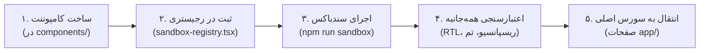

# 🧪 راهنمای فلو کاری توسعه کامپوننت‌ها و استودیو سندباکس (HeroUI v3 Workflow)

این سند، فلو کاری استاندارد توسعه رابط کاربری (UI) پروژه را بر پایه **Atomic Design**، نسخه **HeroUI v3** و موتور استایل‌دهی **Tailwind CSS v4** تعریف می‌کند. تمامی توسعه‌دهندگان و ایجنت‌های هوش مصنوعی موظف به رعایت کامل این دستورالعمل هستند.

---

## 📐 ۱. اصول و قوانین کلیدی توسعه (Core Philosophy)

1. **مبنای اتم‌ها (HeroUI v3 Pure System)**: 
   * هیچ المان پایه‌ای (دکمه، فیلد ورودی، کارت، مودال، سوییچ، تگ و...) نباید از صفر با HTML ساده یا استایل‌های شخصی بازنویسی شود.
   * تمام اتم‌ها باید مستقیماً از کامپوننت‌های رسمی `@heroui/react` به صورت **Compound Component** استفاده کنند (مانند `<Card><Card.Header>`, `<TextField><Label><InputGroup><Input /></InputGroup></TextField>`).
   * در HeroUI v3 هیچ نیازی به `<HeroUIProvider>` نیست.
2. **قانون توسعه سندباکس‌محور (Sandbox First)**: 
   * هیچ کامپوننت جدیدی (اعم از Atoms، Molecules، Organisms یا Templates) نباید مستقیماً در صفحات نهایی پروژه (`app/`) قرار گیرد، مگر اینکه ابتدا در محیط ایزوله **Sandbox (پورت ۶۰۰۶)** رندر، تعامل، تست و تایید شده باشد.
3. **انیمیشن‌های سبک و پیور (Pure CSS / Tailwind v4 Transitions)**:
   * در HeroUI v3 انیمیشن‌ها مبتنی بر CSS و کلاس‌های ترنزیشن Tailwind CSS v4 هستند. از اضافه کردن کتابخانه‌های سنگین جانبی مانند `framer-motion` که الگوی منسوخ v2 است خودداری کنید.
4. **تست همه‌جانبه در سندباکس**:
   * انیمیشن‌ها، ترنزیشن‌ها و وضعیت‌های `Hover` / `Active` / `Focus` / `Disabled` / `Loading`.
   * پاسخگویی کامل در ویوپورت‌های اصلی: **موبایل (375px)**، **تبلت (768px)** و **دسکتاپ (1200px / 100%)**.
   * سلامت کامل در حالت راست‌چین (**RTL**) و نمایش بدون نقص فونت متغیر **ایران‌یکان X متغیر (`IRANYekanXVF`)**.
   * ایزوله‌سازی فیلدهای انگلیسی و دوزبانه (ایمیل، رمز عبور، شماره تلفن و کدها) با `[dir="ltr"]` و `font-mono`.

---

## 📁 ۲. الگوی نام‌گذاری و ساختار پوشه‌ها (Directory Convention)

برای حفظ ساختار تمیز و مقیاس‌پذیر در معماری اتمیک، الگوی مسیردهی زیر الزامی است:

```text
components/
├── atoms/          # اتم‌ها و المان‌های پایه (دکمه‌های سفارشی، تگ‌ها، آیکون‌ها)
├── molecules/      # مولکول‌ها و کارت‌های ترکیبی (کارت لاگین OTP، استپر، فیلد سرچ)
├── organisms/      # ارگانیسم‌ها و بخش‌های بزرگ (هدر بنتو، تایل‌های ویدیو، چت هوش مصنوعی)
├── templates/      # قالب‌ها و لایه‌بندی‌های کامل صفحات (BentoWorkspace، Layouts)
└── sandbox/        # استودیو و رجیستری سندباکس
```

* **ثبت در سندباکس:** هر کامپوننت بلافاصله پس از پیاده‌سازی باید در فایل `components/sandbox/sandbox-registry.tsx` ثبت شود.

---

## 🔄 ۳. فلو کاری گام‌به‌گام توسعه (Step-by-Step Workflow)



### گام ۱: ساخت کامپوننت در سورس اصلی
1. کامپوننت خود را در مسیر مناسب در `components/` بسازید (مثلاً `components/molecules/auth-card.tsx`).
2. از اتم‌های رسمی HeroUI v3 استفاده کنید (`Button`, `TextField`, `Card`, `Chip`, `Switch`, ...).
3. استایل‌های سفارشی را با متغیرهای رنگی oklch و کلاس‌های استاندارد Tailwind v4 پیاده‌سازی کنید.
4. **الزام CSS Logical Properties**: برای فاصله‌گذاری و گوشه‌ها حتماً از ویژگی‌های منطقی استفاده کنید:
   * مارجین و پدینگ: `ms-*`, `me-*`, `ps-*`, `pe-*` (به جای `ml`, `mr`, `pl`, `pr`)
   * تراز متن: `text-start`, `text-end` (به جای `text-right`, `text-left`)
   * گردی گوشه‌ها: `rounded-s-*`, `rounded-e-*`

### گام ۲: ثبت متادیتا در Sandbox Registry
متادیتای کامپوننت را در فایل `components/sandbox/sandbox-registry.tsx` اضافه کنید:
* **Default State**: حالت اولیه و استاندارد
* **Loading State**: حالت لودینگ و اسپینر
* **Disabled State**: حالت غیرفعال
* **Error / Invalid States**: وضعیت‌های خطا و پیام‌های راهنما
* **Persian Presets**: متن‌های نمونه فارسی برای تست راحت

### گام ۳: اجرای سندباکس و اعتبارسنجی
1. اجرای محیط ایزوله:
   ```bash
   npm run sandbox
   ```
2. مرورگر را روی آدرس **`http://localhost:6006/sandbox`** باز کنید.
3. کامپوننت را از سایدبار کاتالوگ (سمت راست) انتخاب کنید.
4. از پنل کنترل پراپ‌ها (سمت چپ)، مقادیر رنگی، سایزها و متون را تست کنید.
5. از هدر بالا، نمایش را در ویوپورت‌های Mobile (375px)، Tablet (768px)، Desktop و تم‌های Light/Dark بسنجید.
6. دراور پایینی بازرسی (**Inspect Tool**) را باز کرده و وابستگی‌های HeroUI و کد JSX زنده را بررسی کنید.

### گام ۴: انتقال به صفحات اصلی پروژه
پس از گذراندن موفقیت‌آمیز تمامی تست‌ها، کامپوننت تایید شده و آماده فراخوانی در صفحات اصلی `app/` است.

---

## 🛠 ۴. ابزارها و امکانات محیط Sandbox

* **Header Tools**:
  * سوئیچر حالت تم (Light / Dark) و پالت‌های برندی هفت‌گانه HeroUI.
  * کنترل‌گر ویوپورت (Mobile 375px | Tablet 768px | Desktop 1200px | 100%).
  * زوم بوم (Zoom ۵۰٪ تا ۱۵۰٪) و تغییر بافت پس‌زمینه (Grid / Dots / Blueprint / Clean).
  * کلید رفرش بوم و سوئیچ جهت RTL/LTR.
  * کلید باز/بستن دراور بازرسی (Inspect Tool).
* **Right Catalog Sidebar**:
  * دسته‌بندی اتمیک کامپوننت‌ها (Atoms, Molecules, Bento Tiles, Organisms).
  * جستجوی لحظه‌ای با میانبر `Ctrl+K` یا `⌘K`.
  * سیستم نشان‌گذاری علاقه‌مندی‌ها (Favorites).
* **Left Controls Sidebar**:
  * پنل کنترل تعاملی پروپ‌ها (Switches, Selectors, Text Inputs با پریست‌های فارسی).
  * کلیدهای سریع تست وضعیت‌های Pre-set (Default, Loading, Disabled, Invalid).
* **Inspect Footer Drawer**:
  * **Source Path**: آدرس دقیق فایل کامپوننت در پروژه با امکان کپی یک‌کلیکه.
  * **HeroUI Dependencies**: لیست وابستگی‌های پایه `@heroui/react`.
  * **Live JSX Code**: تولید و کپی لحظه‌ای قطعه‌کد JSX همراه با پراپ‌های جاری.
  * **Props Table**: جدول مشخصات، نوع داده و توضیحات فارسی پراپ‌ها.

---

## 🚨 ۵. مدیریت خطا در سندباکس (Error Boundary)

در صورت وجود خطای کدنویسی، تایپ‌اسکریپت یا مقادیر نامعتبر، بوم سندباکس توسط **Error Boundary** مهار شده و یک کارت خطای ایزوله نمایش می‌دهد؛ با اصلاح فایل سورس کامپوننت، بوم به صورت خودکار و زنده (Fast Refresh) به‌روزرسانی می‌شود.

---

## ✅ ۶. چک‌لیست تحویل کامپوننت (Definition of Done)

توسعه‌دهنده یا ایجنت هوش مصنوعی تنها زمانی مجاز به اعلام پایان کار کامپوننت است که تمامی موارد زیر تیک خورده باشند:

- [ ] تمام المان‌های پایه کامپوننت از کامپوننت‌های رسمی `@heroui/react` استفاده می‌کنند.
- [ ] تمام فاصله‌گذاری‌ها و گوشه‌ها از Logical Properties (`ms-*`, `me-*`, `ps-*`, `pe-*`, `text-start`, `rounded-s-*`) استفاده می‌کنند.
- [ ] کامپوننت در `components/sandbox/sandbox-registry.tsx` ثبت شده و در پورت ۶۰۰۶ بدون خطا رندر می‌شود.
- [ ] استیت‌های `Disabled`, `Loading` و `Invalid` در پنل کنترل سندباکس بدون باگ بصری تست شده‌اند.
- [ ] فیلدهای دوزبانه و کدهای انگلیسی با `[dir="ltr"]` و کلاس `font-mono` ایزوله شده‌اند.
- [ ] کامپوننت در هر سه ویوپورت Mobile (375px)، Tablet (768px) و Desktop (1200px) کاملاً پاسخگو (Responsive) است.
- [ ] پروژه دستور `npm run build` را با موفقیت و بدون خطای TypeScript یا لینت سپری می‌کند.