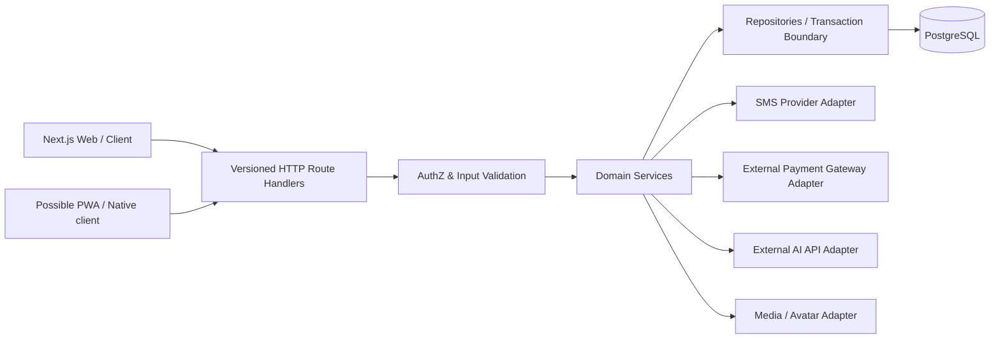

# Architecture & Repository Map

**Approved direction:** `Next.js 16 + Node.js/TypeScript + PostgreSQL`, Modular Monolith, API-first. **Status of directory map:** `PROVISIONAL`, to align with live code before refactoring.

## معماری منطقی

- **Handler:** resolve identity, validate request schema, call service, convert typed outcome to HTTP. **No scoring or payment policy here.**
- **Service/domain:** progress, review, purchase, content rules and transactions; no React or DOM import.
- **Repository:** DB queries + explicit transactions; enforce unique constraints and row locking where relevant.
- **Adapters:** SMS, payment, video, AI, object storage exchangeable with contract tests.
- **Web UI:** routes/cards/hooks, consume API and source-of-truth from server, local FSM solely interaction logic.

## چرا monolith نه بک‌اند مجزا؟
طبق وضعیت فعلی مخزن، App Router و TS از قبل موجود است ولی API/DB صفر است. نگه‌داشتن برنامه در یک deploy کاهش هزینه هماهنگی API/frontend را برای MVP فراهم می‌کند؛ مرز دامنه API-first حفظ می‌شود تا در آینده سرویس جدا یا موبایل بدون تغییر اساسی منطق اضافه شود. نیاز آتی به اپ نصبی به تنهایی ضرورت NestJS مستقل نیست.

## نقشه مخزن «موجود» (از ممیزی؛ قبل از تغییر بازبینی شود)
```text
app/{layout.tsx,page.tsx,providers.tsx,error.tsx,sandbox/}
components/{atoms,molecules,organisms,sandbox}/
hooks/use-{vocabulary,grammar,dictation,pronunciation,completion}-fsm.ts
styles/globals.css
types/{grammar,dictation,pronunciation,completion,index}.ts
AGENTS.md · CLAUDE.md · Workflow.md · package.json
```
**Observed gaps:** `app/api` absent، `BottomNavigation` absent، My Path/Profile/Mistakes routes absent، auth shell mock، video timers mock، lint broken، no tests.

## مقصد پیشنهادی افزایشی (نه دستور migration یکباره)
```text
app/
  api/v1/
    auth/{otp,login,password,...}/
    lessons/[lessonId]/
    exercises/[exerciseId]/attempts/
    video/watch-sessions/
    mistakes/review/
    progress/
    checkout/
    payment/callback/
    me/
  (routes as needed: keep existing / working)
components/          # Preserve Atomic Design + Sandbox
hooks/               # Preserve FSM hooks; adapt via facades
lib/
  domain/
    learning/{scoring,unlock,review}.ts
    identity/{sessions,guest-merge}.ts
    commerce/{entitlements,payments}.ts
  application/{learning,identity,commerce}/
  server/{db,repositories,transaction,authz,validation}/
  integrations/{sms,payment,ai,media}/
  contracts/{api,events,content}.ts
  client/{api,progress-sync}.ts
db/{schema,migrations,seeds}/   # exact naming depends on ORM ADR
tests/{unit,integration,e2e,fixtures}/
```
`lib/domain` must import neither `app/*`, React, Node-request objects nor persistence modules. Server modules must **never** be imported by Client Components. Public DTOs omit answer keys, password hash and gateway secrets.

## Module responsibilities
| Module | Owns | Not allowed |
|---|---|---|
| Content | published lesson/stage/question revision & media pointers | per-user score |
| Learning | attempt grading, video credit, effective score, unlock, mistake state | gateway verification |
| Identity | OTP/password/session, guest merge | lesson scoring formula |
| Commerce | checkout, payment verify, entitlement grant | pedagogical unlock |
| Experience | routes, header/dock/cards, resume navigation | security decisions |
| Observability | structured logs/metrics, correlation IDs | sensitive answer/OTP logs |

## Data flow: exercise answer
1. UI FSM accumulates draft actions.
2. Submit completed attempt with lesson/exercise/contentVersion + client-generated idempotency key.
3. Handler validates identity/guest/free-access/shape; service loads **published question answer keys from server** and computes correctness.
4. Transaction persists immutable attempt + per-question result, mistake events, recomputes effectiveScore and lesson unlock; returns authoritative summary.
5. UI renders result; never sends client-computed grade as authoritative.

## Data flow: playback
Player native events → per-asset watch session adapter → bounded interval/heartbeat telemetry → server merges unique watched ranges → updates video credit once at threshold → updates lesson score/unlock. Time elapsed in `setInterval` is never proof of playback. Exact replay/seek player API may differ by package; adapter contract standardizes it.

## Separation from UI workshop
- `app/sandbox` is preserved and stays independent from real production DB by default.
- `floating-header.tsx`, `phone-login.tsx` and both video files are prototype assets; inspect routes and decide reuse vs isolate (do not delete until parity verified).
- Existing `StageIndicator` assumes solved-only clicks; update to allow navigation to locked card without enabling exercise.
- Existing XP/penalty/streak demo is not approved product contract.

## Infra notes (UNRESOLVED)
Hosting has been chosen by owner but type not shared. Before deploy verify: persistent Node runtime vs serverless, PostgreSQL connectivity/pooling, outbound SMS and payment, webhook public URL/TLS, object store, cron/queue support, secret injection, backup/restore, database migration permissions, CDN/video CORS and geographic latency. **Do not assert Vercel/Docker/VPS without evidence.**

## Security boundaries
- All `/api/v1/**` endpoints validate input and require server-side authorization; guest anonymous ID is not equivalent to authenticated account.
- Central policy: `canReadPublishedLesson`, `canStartExercise`, `hasEntitlement`, `pedagogicallyUnlocked`.
- No trust of `lessonUnlocked`, `isPaid`, `answerCorrect`, `durationWatched` supplied by client without validation.
- Rate-limit OTP, login, reviews, watch events; CSRF prevention for cookie-auth mutations; server-only secrets.
- Prefer explicit versioned DB migrations, API response DTO validation and unique external payment reference.

## Acceptance of architecture phase
- Architecture ADRs selected; import boundaries enforced via lint/tests.
- One server route reads published sample lesson from database; one attempt stored and queried.
- Root app, `/sandbox`, existing FSM interactions still function.
- No package-wide refactor without measured need and rollback plan.

**Related:** `domain-model-and-storage.md`, `api-and-events.md`, `05-delivery/implementation-slices.md`.
