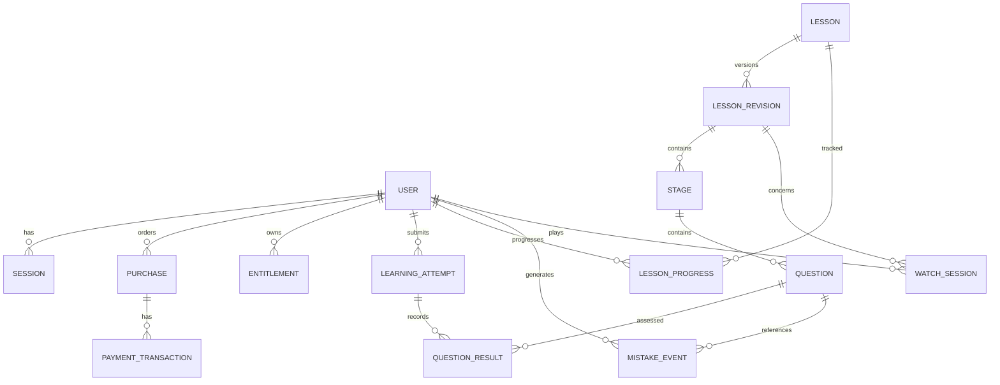

# Domain Model & Persistence Contract

**Authority:** PostgreSQL for accounts, purchases, published lessons, attempts, scores, and unlocks. **Implementation details (ORM/table names):** `PROVISIONAL`; semantic invariants mandatory.

## Logical ERD

## موجودیت‌های توصیه‌شده و حداقل فیلدها
| Logical entity | Required fields / invariants | Status |
|---|---|---|
| `User` | stable id, verified phone canonical nullable until OTP, optional `passwordHash`, displayName, avatarKey, createdAt | PROVISIONAL schema |
| `Session` | id, userId, opaque refresh token hash or DB session id, expiresAt, revokedAt, client metadata minimal | PROVISIONAL |
| `GuestIdentity` | pseudonymous guestId, scoped non-secret local state; optional server-side session only if ADR chooses | PROVISIONAL |
| `Course` | id (`shish-de-60` fixture), title, published status | PROVISIONAL |
| `Lesson` | stable id, sequenceNumber [1..60], courseId, shortTitle, currentPublishedRevisionId, publication status | APPROVED semantics |
| `LessonRevision` | id, lessonId, version integer/string, videoAssetId, `videoWeight`, `unlockThreshold`, contentHash, publishedAt | APPROVED configurable rules; fields provisional |
| `Stage` | id, revisionId, stageOrder, kind `video|exercise|completion?`, exerciseType, configRef, optional activity lock prerequisite | APPROVED stage concept; types provisional |
| `Question` | id, stageId, questionRevision, prompt/config, server-side answer key, `gradingKind`, stableOrder, active | PROVISIONAL |
| `LearningAttempt` | id, subjectId, lessonRevisionId, stageId, attemptType `full|review`, startedAt, completedAt, completionFlag, idempotencyKey, canonical score | APPROVED semantics |
| `QuestionResult` | id, attemptId, questionId, questionRevision, normalized correctness, `answerPayload` sanitized, scoreContribution | PROVISIONAL |
| `MistakeEvent` | id, subjectId, questionId+revision, attemptId, kind `incorrect|corrected|reopened`, eventAt | APPROVED history persistence |
| `MistakeCurrent` | subjectId + questionId + questionRevision, status `needsReview|corrected`, latestWrongAt, latestValidAnswerAt | PROVISIONAL projection |
| `VideoWatchSession` | id, subjectId, lessonRevisionId, videoAssetId, validWatchRanges, maxPlaybackTime, lastPosition, videoCreditAwardedAt | APPROVED watch invariant |
| `LessonProgress` | subjectId + lessonId, effectiveScore, videoCredited, thresholdReachedAt, pedagogicalUnlockedAt, lastActivityAt, currentRevision | APPROVED stored unlock |
| `Entitlement` | id, userId, productId, status, grantedAt, sourcePurchaseId, revokedAt if exceptional | APPROVED commercial gate |
| `Purchase` | id, userId, productId, amountMinor, currency, status, createdAt | APPROVED purchase semantics |
| `PaymentTransaction` | id, purchaseId, provider, providerPaymentId, status, verifiedAt, raw-safe metadata (no credentials) | APPROVED verify requirement |
| `LastActivity` | userId or guestId, lessonId, stageId, draftId, updatedAt, source route, scroll state (bounded) | APPROVED restore |
| `GuestImport` | id, guestBatchId, targetUserId, status, consentAt, checksum, completedAt | APPROVED auto/consent semantics |

### Scope of `subjectId`
Domain services accept a typed `{kind:'user', id}` or `{kind:'guest', id}`; guest must be unable to create entitlement/paid attempts. SQL modeling can use separate nullable keys or a unified subject table by ADR; **do not permit accidental cross-tenant queries**.

## قیود اصلی دیتابیس
- `Lesson(courseId, sequenceNumber)` unique; ۱..۶۰ per chosen course.
- `LessonRevision(lessonId, version)` unique; published revision immutable.
- `Stage(lessonRevisionId, stageOrder)` unique; `Question(stageId, stableOrder)` unique.
- `LearningAttempt(subject, idempotencyKey)` unique; `QuestionResult(attemptId, questionId, revision)` unique.
- `LessonProgress(subject, lessonId)` unique; `MistakeCurrent(subject, questionId, revision)` unique.
- `Entitlement(userId, productId)` unique **active grant** (implement with suitable index/condition).
- `PaymentTransaction(provider, providerPaymentId)` unique when ID exists; `GuestImport(guestBatchId, targetUserId)` unique.
- `0 <= effectiveScore <= 100`; `0 <= videoWeight <= 100`; `0 <= unlockThreshold <= 100`; exercises/weights must validate before publication.
- `QuestionResult` references snapshot revision assessed; old answer must never be regraded against new content silently.

## Transaction boundaries (critical)
1. **Submit full/review attempt:** validate published content, access, schema + answer; atomically append attempt/results and mistake events; recalculate score; upsert lesson progress; record next lesson unlock if threshold crossed. Uniqueness keyed by idempotency key. Fire UI event only **after commit**.
2. **Video threshold:** merge verified ranges; if crossing 80% and no credit yet, write `videoCredited`, recalc score and unlock in same transaction. Concurrent watcher writes use row lock or optimistic version conflict retry.
3. **Guest merge:** staging import and unique batch key; preserve server account history; combine attempts with collision checks, recompute derived progress, and union previously granted pedagogical access. Commit/mark imported atomically; don't delete browser guest data until server acknowledgement.
4. **Payment verify:** lock purchase, record verified gateway transaction once, grant entitlement once; retry and duplicate callback safely return same state.

## Immutable versus derived
- **Immutable/auditable:** published lesson revision, attempt, question result, mistake event, payment verification event.
- **Derived and rebuildable:** lesson effective score, mistake current status, review list, last-open lesson, progress summaries.
- `pedagogicalUnlockedAt` is **monotonic** except exceptional admin revocation with explicit audit (not part of normal progress recalculation).
- `LastActivity` may change backwards when user reviews older lessons; `currentLesson` is the highest sequence currently pedagogically unlocked, never derived from lastActivity.

## Lifecycle & deletes
- Drafts: partial attempt marked incomplete, never count toward score; last saved user state may restore local input.
- Content removal: soft-unpublish; do not destroy historic attempt relations. New content revision does not retroactively overwrite learner result.
- User account deletion/export/retention: legal/business policy `UNRESOLVED`; implement capability boundary and avoid retaining raw microphone recordings by default.
- Password: store Argon2id or comparable vetted hash only (`PROVISIONAL`, choose ADR); OTP only one-way digest and short TTL; never log plaintext.
- Payment: save provider references and safe verification state; do not store card data.

## Database migrations and backups
- Version-control migrations; no destructive auto-sync in production.
- Seed **DEMO_ONLY** fixtures with explicit environment checks and deterministic IDs, no payment enablement by default.
- Before schema changes run backup/restore validation in staging; deployment configuration `UNRESOLVED`.
- Use transactional migrations where possible, backfill in batches, then apply constraints.

## Query needs
- `GET /lessons`: paginated/complete metadata 60 for My Path (small constant set), with derived access flags.
- `GET /lessons/:id`: published revision, public question prompts only, stage statuses.
- `GET /me/progress`: user summaries; avoid N+1 queries.
- `GET /me/mistakes`: sort by latest wrong activity desc, include per-question revisions and preview, cursor pagination.
- `GET /me/last-activity`: lesson/stage/draft/position.

## Test invariants
- attempts deduplicate, correct mistake events append once, score bounded, undo not triggered by weaker attempts.
- guest cannot query another subject; purchase for wrong user never grants entitlement.
- concurrent payments/watch sessions don't duplicate credits.
- removing published question revision does not corrupt existing mistake history.

**Related:** `api-and-events.md`, `02-learning/progression-and-mistake-review.md`, `03-identity-commerce/*`.
